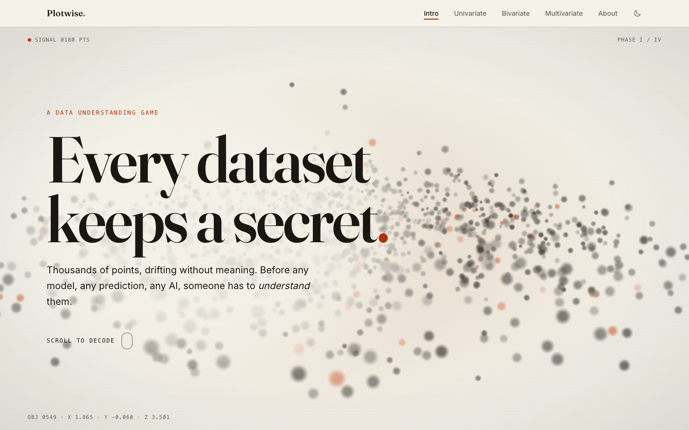
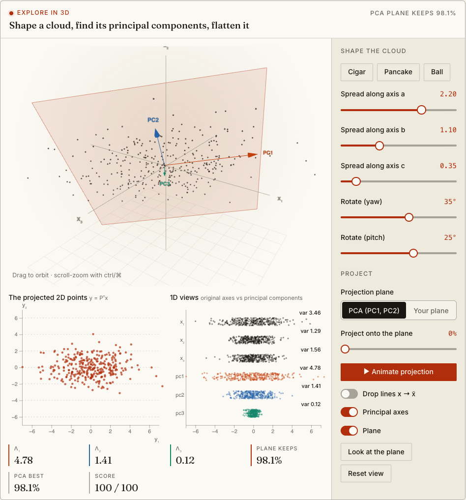

<div align="center">

# Plotwise

**An interactive journey through data understanding.**

Read a dataset one variable, two variables and many variables at a time, by playing with it: univariate, bivariate and multivariate analysis in hands-on labs, entirely client-side.

[](https://developer.mozilla.org/docs/Web/JavaScript)
[](https://vite.dev/)
[](https://d3js.org/)
[](LICENSE)

[Report an issue](https://github.com/LucaBonaldoIT/plotwise/issues) · [Contributing](CONTRIBUTING.md) · [Security](SECURITY.md)

</div>

---

<p align="center">
  
</p>

<p align="center">
  
</p>

## Overview

Plotwise is a free, static, browser-based course on data understanding. Every concept comes with a lab you can drag, tweak and break: move a value and watch the mean and median react, reshape a 3D cloud and find its principal components, let t-SNE pull clusters apart. There is no backend, no account and no tracking, and no data leaves your machine.

## Features

- **Intro:** a scroll-driven title screen that morphs noise into a table and then into the Iris dataset, attribute types, a sorting game and the datasets used throughout
- **Univariate:** categorical and numerical summaries, mean vs median, dispersion, percentiles, skewness, kurtosis and a bank data explorer
- **Bivariate:** visual inspection, dataset slicing, Pearson and Spearman correlation, a correlation-guessing game, spurious correlation and mutual information
- **Multivariate:** the curse of dimensionality, PCA in 3D, linear projection, eigenvectors, biplots, t-SNE vs PCA, and two real-world examples (eating in the UK, a political compass)
- **From scratch:** statistics, PCA (Jacobi eigen-decomposition) and t-SNE are plain JavaScript in `apps/webapp/src/lib`, so you can read exactly what each lab computes
- Light and dark themes, touch-friendly controls and reduced-motion support

## Getting started

### Prerequisites

- Node.js 20 or later
- npm 10 or later

### Run locally

```sh
git clone https://github.com/LucaBonaldoIT/plotwise.git
cd plotwise
npm install
npm run webapp:dev
```

Vite prints the local URL, typically `http://localhost:5173`.

### Scripts

| Command                  | Description                                                |
| ------------------------ | ---------------------------------------------------------- |
| `npm run webapp:dev`     | Start the web app dev server with hot reload               |
| `npm run webapp:build`   | Build the static site into `apps/webapp/dist/`             |
| `npm run webapp:preview` | Serve the production build locally                         |
| `npm run format`         | Format the code with Prettier                              |
| `npm run format:check`   | Check formatting                                           |
| `./build.sh`             | Install dependencies if needed and produce the static site |

### Deployment

`npm run webapp:build` emits a fully static site in `apps/webapp/dist/`. Serve it from any static host (GitHub Pages, Netlify, Cloudflare Pages, S3, or plain nginx). Asset paths are relative, so it also works from a subfolder.

## Project structure

```text
plotwise/
├── apps/
│   └── webapp/          Vite browser app, one HTML page per chapter
│       ├── public/data/ Titanic, Iris and bank datasets (CSV)
│       └── src/
│           ├── lib/     Statistics, PCA, t-SNE, charts and controls
│           ├── pages/   The labs of each chapter
│           ├── scripts/ Page shell, title screens and 3D scenes
│           └── styles/  Page and control styles
├── docs/screenshots/    Images used in this README
├── LICENSE              MIT license
└── build.sh             Static build helper
```

## Contributing

Contributions are welcome. Please read [CONTRIBUTING.md](CONTRIBUTING.md) for the development workflow and pull request guidelines. To report a vulnerability, see [SECURITY.md](SECURITY.md).

## License

Plotwise is released under the [MIT license](LICENSE).

## Acknowledgments

- **Titanic:** the passenger list popularized by the Kaggle competition “Titanic: Machine Learning from Disaster” (891 passengers, training set).
- **Iris:** R. A. Fisher's 1936 measurements of 150 iris flowers, via the UCI Machine Learning Repository.
- **Bank data:** 600 customers and whether they bought a Personal Equity Plan, the classic Weka tutorial dataset.
- **Eating in the UK:** average grams of 17 foods per person per week in the four UK countries, from the UK government's Family Food survey, made famous by Victor Powell and Lewis Lehe's explainer on setosa.io.
- Built with [Vite](https://vite.dev/), [three.js](https://threejs.org/), [D3](https://d3js.org/), [KaTeX](https://katex.org/) and the [paper & ink](https://github.com/LucaBonaldoIT/design) design system, set in Fraunces and Inter.

Created and maintained by [Luca Bonaldo](https://lucabonaldo.dev).
